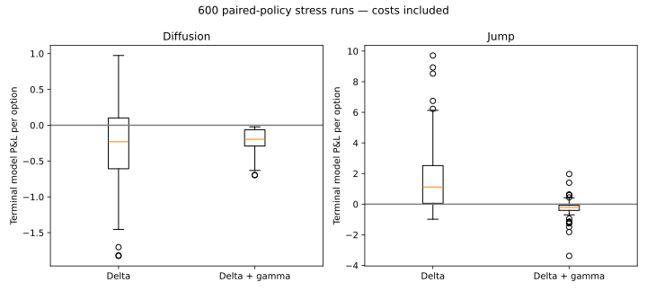

# Derivatives Hedging Research

## Distinct objective
Measure nonlinear option risk and hedge error, rather than predict equity direction. This extends the prior options lab with a second-option delta/gamma hedge, explicit cash financing, position caps, transaction costs and separate stress seeds.

## Mathematics and conventions
European Black–Scholes, zero dividends. d1=[ln(S/K)+(r+σ²/2)T]/(σ√T), d2=d1−σ√T; C=SΦ(d1)−Ke^(−rT)Φ(d2). Delta=Φ(d1), gamma=φ(d1)/(Sσ√T), vega=Sφ(d1)√T. Vega/rho are per unit change, theta per year; IV uses bounded bisection. Finite-difference tests validate Greeks.

For one long target call and a longer-dated hedge call H, q_H=−Γ_target/Γ_H (capped at ±5; tiny denominators use zero). Stock hedge q_S=−Δ_target−q_HΔ_H. Cash pays purchases/receives sales and grows at exp(rΔt). Every rebalance satisfies wealth_after=wealth_before−fee. The target expires after 63 observations; the hedge call has 21 additional observations and is liquidated at the target expiry. All residual delta/gamma and wealth balances are recorded in the simulator ledger.

## Results
The inherited experiment has 900 held-out daily/band/unhedged evaluations. The extension adds 600 delta/delta-gamma evaluations across diffusion and jump scenarios, with 5bp stock and 20bp option-premium trading costs. On diffusion scenarios, terminal P&L RMSE is 0.615 for delta versus 0.249 for delta/gamma; on jump scenarios, 2.497 versus 0.540. These are currency units per model option, not percentage returns. The benefit is conditional on both options sharing the pricing model and idealized liquidity.



## Tests and evidence
26 tests: 20 inherited pricing/hedging tests plus six gamma-hedge tests for neutrality, wealth conservation, liquidation, fee direction, position cap and input validation. `run.py` produces inherited experiments, `gamma_hedge.py` the new experiments, `results/` contains CSV/JSON/SVG outputs. Earlier 29-block DLF underlying replay is retained and clearly uses hypothetical option prices, not historical option chains.

## Sources, assumptions and limitations
Synthetic source: `hedging.py`, fixed seeds recorded in code and reports, accessed 2026-10-24. Parameters include 25% pricing volatility, 2% financing rate and 1/252 time step. The jump generator and realized-volatility regime assumptions are documented in `docs/BASE_METHODOLOGY.md`.

Concept reference: [OCC/OIC Greeks guide](https://prd-web.optionseducation.org/advancedconcepts/understanding-options-greeks), accessed 2026-10-24. Greeks are theoretical local sensitivities. Same-close model fills, fractional option units, unrestricted stock borrow and liquid hedge options are assumed. No actual chain, margin, bid/ask surface, dividends, taxes or empirical calibration. Positive delta-only jump P&L can reflect pricing-model misspecification; it is not demonstrated alpha. Gann rules are not claimed because they are not implemented or validated here.

## Evidence and interpretation

All generated inputs are assumptions, not empirical observations. Historical experiments are retrospective research, not a live track record. No employer sponsorship or investment recommendation is implied. Code was developed with AI assistance; the candidate must be able to reproduce, explain and modify it in interviews.

Source names, URLs and access dates are recorded in results JSON and the inherited methodology. Raw vendor price data are not redistributed. Use a lawfully obtained local CSV to reproduce historical runs; the default reproduction is fully offline; synthetic experiments and cached derived historical outputs are identified separately.

## Reproduce and test

Python 3.12:
```bash
python -m pip install -r requirements.txt
python reproduce.py
```
GitHub Actions runs the same research entry point. Historical caches are deliberately excluded from CI. Generated CSVs are the audit trail; SVG figures are derived from those CSVs or the same in-memory results.
